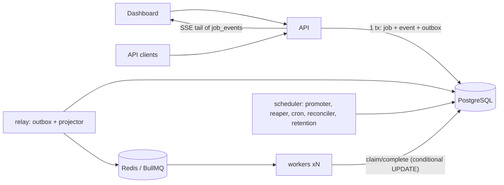

# ScaleFlow

An open-source, educational **distributed job processing and event delivery platform**: submit jobs
over a REST API, run them on horizontally scaled workers with retries, backoff, dead-lettering and
schedules, and watch them live in a dashboard. Built to demonstrate durable publication
(transactional outbox), at-least-once delivery with exactly-once *claims*, CQRS read models,
commit-ordered real-time events, and honest operational limits.

Stack: TypeScript, Node.js 24, Fastify 5, PostgreSQL 17, Redis 8 + BullMQ, Zod, OpenAPI, Server-Sent
Events, Next.js 16 + TanStack Query + Tailwind + Recharts, Prometheus/Grafana, Vitest, Playwright, k6.

## Architecture



Full design, state machine, guarantees and data model: **[docs/architecture.md](docs/architecture.md)**.

## Features

- Jobs: immediate, delayed, cron schedules (exactly one job per tick), retries with exponential
  backoff + jitter, max attempts, dead-letter view, manual replay, cancellation, timeouts, leases with
  crash recovery, graceful worker drain, duplicate-delivery protection.
- Idempotent submission (`Idempotency-Key`, race-safe), batch submission (atomic, ≤100).
- Transactional outbox + dispatch reconciler: an accepted job cannot silently disappear, even if Redis loses data.
- Multi-tenant projects, API keys (hashed, scoped, revocable, rotatable), roles, audit log.
- Real-time SSE with gap-free resume (`Last-Event-ID`) using a commit-ordered `(xid, id)` cursor.
- CQRS: write model + projected read model for dashboards; optional read replica with LSN read-your-writes.
- Rate limiting, backpressure, payload limits, SSRF-protected signed webhooks.
- Prometheus metrics, Grafana dashboard, alert rules, runbooks.

## Quick start

```bash
cp .env.example .env
docker compose up -d postgres redis
npm ci
npm run db:migrate
npm run db:seed        # prints a demo login and an API key
npm run dev            # api :4000, worker, relay, scheduler, dashboard :3000
```

Open http://localhost:3000 (seed login `demo@scaleflow.dev` / `scaleflow-demo-password`) and the API
docs at http://localhost:4000/docs. Whole stack in containers: `docker compose up -d --build`
(Grafana on :3001, Prometheus on :9090).

## Tests

```bash
npm run lint && npm run typecheck
npm test                 # unit + integration (needs PostgreSQL + Redis; TEST_DATABASE_URL / TEST_REDIS_URL)
npm run test:e2e         # Playwright against the running stack
k6 run load/write-heavy.js   # see docs/benchmarks.md
```

## Documentation

[API guide](docs/api.md) · [Architecture](docs/architecture.md) · [Operations & runbooks](docs/operations.md) ·
[Benchmarks (measured)](docs/benchmarks.md) · [Scaling](docs/scaling.md) · [Deployment](docs/deployment.md) ·
[Security](docs/security.md) · [Dashboard](docs/dashboard.md) · [Project status](PROJECT_STATUS.md)

## System Design Decisions

| Component | Why | Alternatives considered |
| --- | --- | --- |
| PostgreSQL as source of truth | Transactions make job + event + outbox atomic; conditional UPDATEs enforce the state machine | Redis-only queues (state lost on Redis failure) |
| Transactional outbox | No lost/phantom jobs between DB commit and queue publish | Direct publish (unsafe), CDC/Debezium (heavier ops) |
| BullMQ as delivery only | Fast blocking delivery, concurrency, stalled detection; retries/delays stay in PostgreSQL | SKIP LOCKED polling queue (pg-boss), SQS, RabbitMQ |
| Separate api/worker/relay/scheduler processes | Independent scaling and failure isolation | Monolith (stuck handlers stall dispatch), microservices (cost without benefit) |
| SSE over Socket.IO | One-way updates, native resume via Last-Event-ID, no sticky sessions | Socket.IO, polling |
| Projected read model | O(1) dashboard counts without hot counter rows | `count(*)` per refresh, in-transaction counters |
| UUIDv7 ids | Time-ordered keyset pagination, index locality | bigserial (enumerable), UUIDv4 (random inserts) |

**Guarantees:** submission exactly-once per idempotency key; delivery at-least-once; claim at-most-once
per attempt; side effects at-least-once (handlers receive a stable job id for downstream dedupe).
**Measured bottlenecks:** one API process ≈1,000 submissions/s (CPU), Redis single core next, per-job
DB overhead caps short jobs at ≈550/s on one laptop — see [benchmarks](docs/benchmarks.md).

## Limitations and Production Hardening

- Docker images and docker-compose were **not built or run** during development (no Docker available); CI builds them.
- GitHub Actions workflow is written but has **not been executed**; its steps were run locally.
- Prometheus/Grafana configuration was not run against a live Prometheus; metric names were checked against `/metrics`.
- Read-replica routing is implemented but untested against a real replica.
- Single PostgreSQL/Redis in the local stack are single points of failure (see [operations](docs/operations.md#single-points-of-failure)).
- Auth is development-grade: no SSO/MFA, email verification or password reset; one global webhook signing secret.
- No cooperative cancellation of running jobs; no job priorities; no sandboxing of handlers.
- Load numbers come from one laptop with all components co-located.

## Roadmap

Batch claims for higher worker throughput · time-partitioned `jobs`/`job_events` · per-project webhook
secrets · cooperative cancellation · priorities · OIDC SSO · generated TypeScript SDK from OpenAPI ·
CDC-based event log at large scale.

## License

[MIT](LICENSE)
