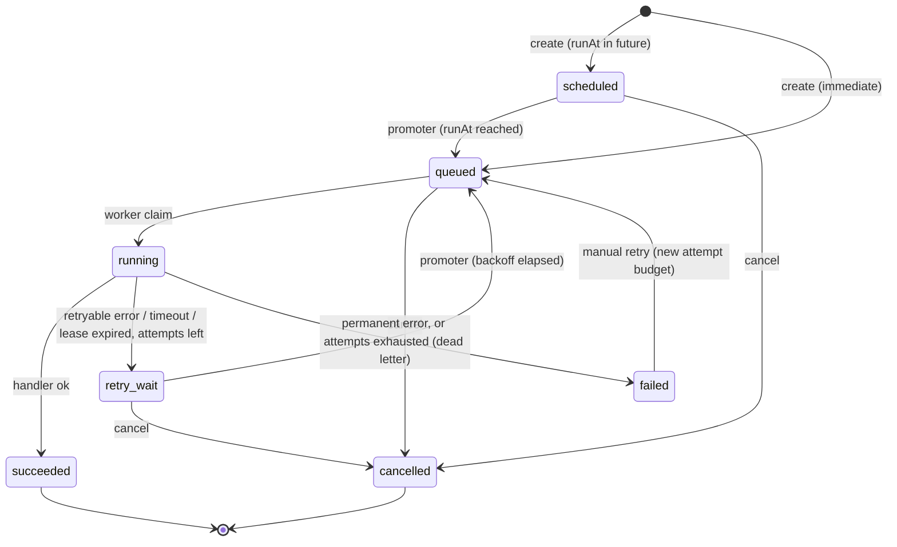
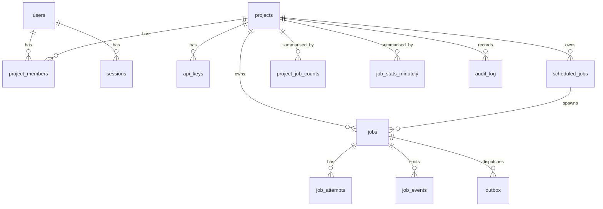

# ScaleFlow Architecture

This document describes how ScaleFlow is put together, why, and what each piece guarantees. It is
the reference for the code: where the code and this document disagree, that is a bug.

- [1. Components and processes](#1-components-and-processes)
- [2. Life of a job](#2-life-of-a-job)
- [3. Job state machine](#3-job-state-machine)
- [4. Durable publication: the transactional outbox](#4-durable-publication-the-transactional-outbox)
- [5. Delivery vs execution guarantees](#5-delivery-vs-execution-guarantees)
- [6. The event log, real-time delivery and reconnects](#6-the-event-log-real-time-delivery-and-reconnects)
- [7. CQRS: write side, read side, read model](#7-cqrs-write-side-read-side-read-model)
- [8. Caching](#8-caching)
- [9. Data model](#9-data-model)
- [10. Tenancy, authentication and authorization](#10-tenancy-authentication-and-authorization)
- [11. Background maintenance loops](#11-background-maintenance-loops)

## 1. Components and processes

ScaleFlow is one TypeScript codebase (`apps/server`) that is started as **four process types**, plus
the Next.js dashboard. They share the domain and infrastructure modules but scale and fail
independently.

| Process     | Entry point                     | Responsibility                                                                 | Scales by                     |
| ----------- | ------------------------------- | ------------------------------------------------------------------------------ | ----------------------------- |
| `api`       | `src/processes/api.ts`          | REST API (commands + queries), SSE stream, OpenAPI, `/metrics`                 | Request rate, SSE connections |
| `worker`    | `src/processes/worker.ts`       | Consumes BullMQ, claims jobs in Postgres, executes handlers, records results   | Job throughput                |
| `relay`     | `src/processes/relay.ts`        | Outbox dispatcher (Postgres → BullMQ) and read-model projector                 | Outbox volume (rarely needed) |
| `scheduler` | `src/processes/scheduler.ts`    | Recurring schedules, promotion of delayed/retrying jobs, lease reaper, dispatch reconciliation, worker liveness, retention | Almost never |
| `dashboard` | `apps/dashboard`                | Next.js UI; talks to the API only                                              | Static-ish                    |

Infrastructure: **PostgreSQL** (source of truth), **Redis** (BullMQ, cache, rate limits),
**Prometheus + Grafana** (observability).

Why not one process? Workers burn CPU and hold long-running executions; the API must stay
responsive. The relay and scheduler are small, but isolating them means a stuck handler or a
saturated API cannot stop accepted jobs from being dispatched or retried. Why not more processes?
Each extra service adds deployment, monitoring and network failure modes. The real-time stream
lives in the `api` process (in its own module, `src/modules/realtime`) because it needs the same
authentication and is cheap; it can be split out later because it has no shared in-memory state
with request handling.

```mermaid
flowchart LR
  subgraph Clients
    D[Dashboard<br/>Next.js]
    C[API clients<br/>API key]
  end

  subgraph API["api (N replicas)"]
    CMD[Command handlers<br/>write path]
    QRY[Query handlers<br/>read path]
    SSE[SSE hub<br/>event-log tailer]
  end

  subgraph PG[(PostgreSQL - source of truth)]
    JOBS[jobs / job_attempts]
    EV[job_events<br/>append-only log]
    OB[outbox]
    RM[read model<br/>job_stats_minutely<br/>project_job_counts]
  end

  subgraph R[(Redis)]
    BQ[BullMQ queues]
    CACHE[cache + rate limits]
  end

  RELAY["relay<br/>outbox dispatcher + projector"]
  W["worker (M replicas)"]
  S["scheduler<br/>promoter, reaper, cron, retention"]
  PROM[Prometheus] --> GRAF[Grafana]

  D -- cookie session --> API
  C -- Bearer API key --> API
  CMD -- "1 tx: job + event + outbox row" --> PG
  QRY --> PG
  QRY <--> CACHE
  SSE -- "poll by (tx_id,id) watermark" --> EV
  RELAY -- claim pending rows --> OB
  RELAY -- add dispatch --> BQ
  RELAY -- fold events --> RM
  BQ -- deliver --> W
  W -- "claim / complete / fail (1 tx each)" --> PG
  S -- "promote due jobs, recover leases" --> PG
  PROM -. scrape .-> API & W & RELAY & S
```

## 2. Life of a job

```mermaid
sequenceDiagram
  autonumber
  participant Client
  participant API
  participant PG as PostgreSQL
  participant Relay
  participant Redis as Redis (BullMQ)
  participant Worker
  participant SSE as API SSE hub

  Client->>API: POST /v1/projects/:id/jobs (Idempotency-Key)
  API->>PG: BEGIN; INSERT jobs (queued); INSERT job_events (job.created);<br/>INSERT outbox (job.dispatch); COMMIT
  API-->>Client: 201 {job} (or 200 replay for same key)
  Relay->>PG: UPDATE outbox SET locked_until=... (SKIP LOCKED batch)
  Relay->>Redis: addBulk(jobId = "<job>-a<attempt>")
  Relay->>PG: UPDATE outbox SET published_at = now()
  Redis->>Worker: deliver dispatch
  Worker->>PG: UPDATE jobs SET status='running' WHERE status='queued' AND attempt_count = n-1<br/>+ INSERT job_attempts + job_events (job.started)
  Note over Worker: 0 rows updated ⇒ duplicate/stale delivery ⇒ ack and skip
  Worker->>Worker: run handler (timeout via AbortSignal, lease renewals)
  Worker->>PG: UPDATE jobs SET status='succeeded' WHERE status='running' AND attempt_count=n<br/>+ attempt row + job_events (job.succeeded)
  SSE->>PG: SELECT job_events WHERE (tx_id,id) > cursor AND tx_id < snapshot xmin
  SSE-->>Client: event: job.succeeded (id: "<tx>.<id>")
```

Delayed jobs (`runAt` in the future) are inserted as `scheduled` without an outbox row; the
scheduler's **promoter** moves them to `queued` and writes the outbox row in the same transaction
once they are due. Retries work the same way via `retry_wait`. This keeps all timing state in
PostgreSQL: Redis only ever holds jobs that are ready to run now.

## 3. Job state machine



The transition table lives in [`src/domain/job-state.ts`](../apps/server/src/domain/job-state.ts) and is
enforced twice:

1. **In code** – `assertTransition(from, to)` throws `InvalidTransitionError` for anything not in
   the table (unit-tested exhaustively over all 49 pairs).
2. **In SQL** – every state change is a conditional update
   (`UPDATE jobs SET status = $to ... WHERE id = $id AND project_id = $p AND status = ANY($allowedFrom)`).
   Concurrency races (cancel vs. claim, two workers claiming the same dispatch, a stale worker
   finishing after its lease was recovered) are resolved by the row lock: exactly one statement
   matches, the others update zero rows and report a conflict. No application-level locks.

`running` cannot be cancelled: the handler may already be producing side effects, and pretending
otherwise would be lying. Cancel returns `409 job_not_cancellable`. Cooperative cancellation is on
the roadmap.

**Retry policy.** Each job carries `maxAttempts` (1–25), `backoff` (`exponential` or `fixed`),
`baseDelayMs` and `maxDelayMs`. The delay before attempt *n+1* is
`min(maxDelayMs, baseDelayMs · 2^(n-1))` with **jitter**: the actual delay is uniform between 10% of
that ceiling (at least 100 ms, to avoid hot retry loops) and the ceiling. This spreads retries from a
mass failure instead of synchronising them. Errors are classified:
`PermanentJobError` (e.g. HTTP 4xx from a webhook target, invalid payload) fails immediately;
everything else (network errors, timeouts, 5xx, 429) is retryable. Manual retry of a `failed` job
resets the *per-run* counter (`run_attempts`) but the global `attempt_count` keeps increasing so
attempt numbers stay unique.

## 4. Durable publication: the transactional outbox

The problem: "write the job to Postgres, then push it to Redis" are two systems. If the process
dies between the two, either the job exists but is never queued (silent loss), or the push
happened but the transaction rolled back (a phantom job).

ScaleFlow writes an `outbox` row **in the same transaction** as the job. The relay then:

1. Claims a batch: `UPDATE outbox SET locked_until = now() + 30s, attempts = attempts + 1
   WHERE id IN (SELECT id ... WHERE published_at IS NULL AND available_at <= now() AND
   (locked_until IS NULL OR locked_until < now()) ORDER BY id LIMIT 200 FOR UPDATE SKIP LOCKED)`.
   The claim commits immediately, so no transaction is held open across the network call.
2. Publishes to BullMQ with a deterministic job id (`<jobId>-a<attemptNumber>`). BullMQ ignores an
   `add` whose id already exists, so republishing is harmless.
3. Marks the rows `published_at = now()`. On failure it sets `available_at = now() + backoff` and
   `last_error`, and the rows are retried. If the relay crashes, the lease expires and another relay
   instance picks the rows up.

Multiple relays are safe (`SKIP LOCKED` + leases). The result is **at-least-once publication**;
duplicates are absorbed by the BullMQ id and, more importantly, by the worker's conditional claim.

**Belt and braces.** If Redis loses data (no persistence, failover without replication, manual
flush), a job can be `queued` in Postgres with no BullMQ counterpart. The scheduler's **dispatch
reconciler** periodically looks at jobs that have been `queued` for longer than a threshold, asks
BullMQ whether their dispatch still exists in a pending state, and re-enqueues the ones that do not
via a new outbox row. An accepted job therefore cannot silently disappear: it is either in a
terminal state in Postgres, or some loop will (re)dispatch it.

| Approach                                | Atomic with DB write | Extra infra        | Latency           | Ordering            | Notes |
| --------------------------------------- | -------------------- | ------------------ | ----------------- | ------------------- | ----- |
| Direct publish after commit             | No                   | None               | Lowest            | n/a                 | Loses jobs on crash between commit and publish; publishing *before* commit creates phantom jobs. |
| **Transactional outbox (chosen)**       | Yes                  | None (a table + relay) | + relay poll interval (≈100–500 ms) | Per relay batch | Simple, testable locally, at-least-once. Costs extra writes and table churn (handled by a partial index and retention). |
| Change data capture (Debezium / logical decoding) | Yes        | Kafka Connect / a logical replication slot | Low | Commit order | No polling and true commit ordering, but adds operational weight (slot management, WAL retention risk if the consumer stalls). The natural next step at very high volume. |

## 5. Delivery vs execution guarantees

- **Submission** is exactly-once *per idempotency key*: a unique index on
  `(project_id, idempotency_key)` plus `INSERT ... ON CONFLICT DO NOTHING` makes concurrent
  duplicates converge on one row. A replay with the same key and the same body returns the original
  job (`200`, `Idempotent-Replayed: true`); the same key with a different body is rejected (`422`).
- **Queue delivery** is at-least-once (outbox republishing, BullMQ stalled-job redelivery, the
  reconciler).
- **Execution claims** are at-most-once *per attempt number*: the claim is a conditional update
  on `(status = 'queued', attempt_count = n - 1)`, so two deliveries of the same dispatch cannot both
  start attempt *n*.
- **Side effects** are at-least-once. If a worker dies after the handler called a webhook but before
  recording success, the lease expires and the job is retried — the webhook fires again. No queue can
  avoid this on its own, because "perform side effect" and "record that it was performed" are two
  different systems (the same reason the outbox exists). Exactly-once *effects* need the downstream
  to cooperate: ScaleFlow sends a stable `ScaleFlow-Job-Id` / `Idempotency-Key` header
  (`<jobId>`) on every webhook attempt so the receiver can deduplicate, and handlers receive
  `jobId` and `attempt` for the same purpose.

## 6. The event log, real-time delivery and reconnects

Every state change inserts a row into `job_events` in the same transaction as the change. The log
is the durable record; real-time delivery is a view over it, never the only copy.

**Choice: Server-Sent Events, not Socket.IO.** Updates flow one way (server → browser). SSE is plain
HTTP (works through proxies and HTTP/2, no sticky sessions, no extra protocol or client library),
and – decisively – it has resumption built in: the browser automatically reconnects and sends the
last seen event id in `Last-Event-ID`. That maps directly onto replaying from the durable log.
Socket.IO's extras (bidirectional messages, rooms, fallbacks) would be unused, and scaling it across
API replicas needs sticky sessions plus a Redis adapter.

**Commit-ordered cursors.** A naive cursor (`id > last_id`) over a sequence-backed table is wrong
under concurrency: transaction A can take id 100, transaction B id 101, and B can commit first. A
reader that saw 101 and then advances past it never sees 100. ScaleFlow stores the writing
transaction's id (`tx_id xid8 DEFAULT pg_current_xact_id()`) on each event and reads with

```sql
WHERE (tx_id, id) > ($cursor_tx, $cursor_id)
  AND tx_id < pg_snapshot_xmin(pg_current_snapshot())
ORDER BY tx_id, id
```

`pg_snapshot_xmin` is the oldest transaction still in flight, so every event below it is from a
transaction that has already committed or aborted – nothing can appear behind the cursor later.
The SSE event id is `"<tx_id>.<id>"`. The same query serves both the live tail (each API process
polls every 250 ms and fans out to its local connections) and reconnect replay, so resumption is
exact. The cost: a long-running write transaction holds the watermark back and delays events
until it finishes – one reason retention deletes run in small batches. Transaction ids are
cluster-wide, so this includes transactions in *other databases on the same PostgreSQL server*
(found the hard way: the integration tests run several databases in parallel). Give ScaleFlow its
own cluster in production, and alert on `scaleflow_projection_lag_seconds`.
(`NOTIFY` was considered to cut latency, but it serialises commits of notifying transactions behind
a global lock, which is the wrong trade on the hottest write path.)

**Reconnect reconciliation in the dashboard.** On every (re)connect the dashboard (a) receives any
missed events by replay and (b) invalidates its TanStack Query caches, re-reading job state from the
API. The table state shown is therefore always the database state; events only make it arrive
sooner. If a client is gone longer than the replay window (`SSE_REPLAY_MAX_EVENTS`), the server
sends a `reset` event and the client does a full refetch.

**Scope.** A stream is opened per project (`GET /v1/projects/:id/stream`); the project is
authorized exactly like any other request, and the tailer filters events by `project_id` before
fan-out. Worker availability and queue health are sent as periodic `system.snapshot` events (they
are point-in-time gauges – the next snapshot supersedes the last, so they need no replay).

## 7. CQRS: write side, read side, read model

The split is logical and pragmatic, not ceremonial:

- **Commands** (`src/modules/jobs/commands/*`) – create, batch-create, cancel, retry, and the worker
  transitions (claim, complete, fail). They use the write pool, run in explicit transactions, enforce
  the state machine and append events/outbox rows. They return the new state plus the commit
  position used for read-your-writes.
- **Queries** (`src/modules/jobs/queries/*`, `src/modules/metrics`) – list, get, attempts, events,
  metrics. They use the **read pool**, never take locks, never write, and are free to use caches and
  denormalised data.
- **Read model** – `project_job_counts` (current count per status) and `job_stats_minutely`
  (per-minute throughput plus latency histograms). They are **projections** of `job_events`,
  maintained by the projector in the relay process. The projector reads the log with the same
  commit-ordered cursor and applies a batch of increments *and* its checkpoint in one transaction, so
  each event is folded in exactly once even across crashes. A Postgres advisory lock keeps a single
  active projector; standby instances take over if it dies.

Why a projection instead of `count(*) ... GROUP BY status`? Counting is O(rows) per dashboard
refresh, and updating a counter row inside every job transaction would serialise all writes for a
busy project on one hot row. The projection batches hundreds of events into a handful of upserts
from a single writer.

**Consistency.**

| Data                         | Source                 | Consistency                                    |
| ---------------------------- | ---------------------- | ---------------------------------------------- |
| Job detail, list, attempts   | `jobs` table via read pool | Strong on a single node; with a replica, read-your-writes via LSN token (below) |
| Job detail (cached)          | Redis, versioned       | Invalidated after each commit; bounded by TTL if invalidation is lost |
| Status counts, charts        | Projection             | Eventually consistent, typically < 1 s behind (`scaleflow_projection_lag_seconds`) |
| Real-time events             | Event log              | Commit-ordered, gap-free, at-least-once (clients deduplicate by id) |

**Read replicas.** `DATABASE_READ_URL` configures a separate read pool. If it is not set, the read
pool points at the primary (that is the default local setup – there is no replica pretending to
exist). When it is set, the **read router** provides read-your-writes: command responses carry an
`X-ScaleFlow-Commit-LSN` header (`pg_current_wal_lsn()` after commit); a client that sends it back as
`X-ScaleFlow-Min-LSN` is routed to the replica only if `pg_last_wal_replay_lsn()` on the replica has
reached it, otherwise to the primary. The dashboard does this automatically. Requests without a
token accept replica lag. Running a real replica requires streaming replication
(`pg_basebackup -R`, a replication slot, monitoring of `pg_stat_replication`), described in
[deployment.md](deployment.md#read-replicas).

## 8. Caching

| Cache                 | Key                              | TTL                    | Invalidation                                    | Stampede control |
| --------------------- | -------------------------------- | ---------------------- | ----------------------------------------------- | ---------------- |
| Job detail            | `sf:job:<projectId>:<jobId>`     | 2 s active, 5 min terminal | Version tombstone written after every committed change | Versioned compare-and-set (Lua) |
| API key / session auth | `sf:auth:key:<hash>` / `sf:auth:sess:<hash>` | 60 s | `DEL` on revoke / logout / rotate             | n/a (cheap) |
| Project metrics       | `sf:metrics:<projectId>:<window>` | 5 s fresh, 60 s stale  | Time-based                                      | Single-flight (in-process) + Redis lock + stale-while-revalidate |
| Queue health          | `sf:system:queues`               | 2 s                    | Time-based                                      | Single-flight + Redis lock |

**The versioned job cache.** Plain cache-aside has a race: a reader loads version 3 from the
database, a writer commits version 4 and deletes the key, then the reader writes version 3 into the
cache, which now serves stale data until TTL. ScaleFlow's writers instead set a short-lived
*tombstone* carrying the new version; readers only populate the cache through a Lua script that
refuses to write a version lower than the one already present (tombstone included). Every job row
has a `version` column incremented on every update. This is covered by an integration test that
interleaves the reader and writer deliberately.

List endpoints are not cached: filter × cursor combinations have low hit rates, and keyset pagination
over the right index is already cheap.

## 9. Data model



Identifiers are **UUIDv7**, generated in the application: globally unique without coordination,
safe to expose, and time-ordered, so B-tree inserts stay append-mostly and `ORDER BY id DESC` gives
creation order for keyset pagination. `createdAfter`/`createdBefore` filters are translated into
UUIDv7 bounds so they use the same index. Log-like tables (`job_events`, `outbox`, `audit_log`) use
`bigint` identity keys.

The full DDL with comments is in [`apps/server/migrations`](../apps/server/migrations). Every index
is annotated with the query it serves. Highlights:

| Index | Serves |
| ----- | ------ |
| `jobs (project_id, id DESC)` | Job list, newest first, keyset pagination |
| `jobs (project_id, status, id DESC)` | Job list filtered by status (incl. the dead-letter view) |
| `jobs (project_id, idempotency_key)` UNIQUE | Idempotent submission |
| `jobs (run_at) WHERE status IN ('scheduled','retry_wait')` | Promoter |
| `jobs (lease_expires_at) WHERE status = 'running'` | Lease reaper |
| `jobs (queued_at) WHERE status = 'queued'` | Dispatch reconciler, oldest-queued-age metric |
| `outbox (available_at, id) WHERE published_at IS NULL` | Relay claim; stays tiny because published rows leave the index |
| `job_events (tx_id, id)` | Global tailer (SSE hub, projector) |
| `job_events (project_id, tx_id, id)` | SSE replay and project event history |
| `job_events (job_id, id)` | Job timeline |

**Retention** (configurable, executed by the scheduler in batches of 5 000 rows): terminal jobs 30
days (attempts and events cascade), job events 14 days, published outbox rows 24 h, per-minute stats
90 days, offline worker records 7 days, expired sessions immediately, audit log 365 days. At larger
scale `job_events` and `jobs` should become time-partitioned tables so retention is `DROP PARTITION`
instead of `DELETE` (see [scaling.md](scaling.md)).

## 10. Tenancy, authentication and authorization

- **Users** authenticate with email + password (scrypt, parameters stored with the hash) and receive
  an opaque session token in an `HttpOnly`, `SameSite=Lax` cookie (`Secure` in production). Only a
  SHA-256 hash of the token is stored.
- **API keys** look like `sf_<keyId>_<secret>` with 256 bits of randomness. The plaintext is shown
  once; the database stores `SHA-256(full key)` (a fast hash is appropriate for high-entropy secrets
  – a password KDF would add latency to every request without adding security). Keys are scoped to
  one project, carry scopes (`jobs:read`, `jobs:write`), can expire, can be revoked (effective
  immediately – the auth cache entry is deleted) and rotated (the old key keeps working for a grace
  period you choose).
- **Authorization** is per project. A user's role (`owner`, `developer`, `viewer`) or an API key's
  scopes determine allowed actions. Every query includes `project_id = $projectId` in its `WHERE`
  clause and the job's id; a job id from another project is indistinguishable from a non-existent one
  (`404`), so ids cannot be probed.
- **CSRF**: cookie-authenticated state-changing requests must carry an `Origin` header that matches
  `CORS_ORIGINS`; API-key requests are not cookie-based and are unaffected.

## 11. Background maintenance loops

All loops are safe to run in multiple instances (they use `FOR UPDATE SKIP LOCKED` or an advisory
lock), are individually timed, export metrics, and stop cleanly on `SIGTERM`.

| Loop                | Process   | Interval | What it does |
| ------------------- | --------- | -------- | ------------ |
| Outbox dispatcher   | relay     | 200 ms (immediate re-poll when a batch was full) | Publishes pending outbox rows to BullMQ |
| Projector           | relay     | 500 ms   | Folds `job_events` into the read model |
| Promoter            | scheduler | 500 ms   | `scheduled`/`retry_wait` → `queued` when due (+ outbox row) |
| Cron                | scheduler | 1 s      | Creates jobs for due recurring schedules (idempotency key per tick) |
| Lease reaper        | scheduler | 5 s      | `running` jobs whose lease expired → `retry_wait` or `failed` |
| Dispatch reconciler | scheduler | 30 s     | Re-dispatches `queued` jobs missing from BullMQ |
| Worker liveness     | scheduler | 10 s     | Marks workers without a heartbeat as `offline` |
| Retention           | scheduler | 60 s     | Batched deletes per policy above |
