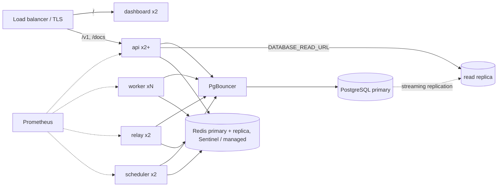

# Production deployment guide

ScaleFlow ships as two images built from this repository:

- `apps/server/Dockerfile` - one image for `api`, `worker`, `relay`, `scheduler` and the
  `migrate`/`seed`/`rebuild-projections` commands (choose with the container command).
- `apps/dashboard/Dockerfile` - the Next.js dashboard (`NEXT_PUBLIC_API_URL` is a **build** argument).

> The Docker images and `docker-compose.yml` are written for this purpose but were **not built or
> run as a stack during development** (no Docker on the development machine). CI builds both images and validates the compose file; treat the
> first deployment as a verification step. The same commands (`node dist/processes/*.js`, the
> Next.js standalone server) were run natively and work.

## Topology

Serve the dashboard and API from the **same site** (e.g. `app.example.com` and `api.example.com`, or
one origin with `/v1` routed to the API) so the session cookie is first-party.

## Checklist

1. **Configuration** (all via environment; see `apps/server/src/config/env.ts` for every option):
   - `NODE_ENV=production`, `COOKIE_SECURE=true`, `TRUST_PROXY=true` behind a proxy.
   - `WEBHOOK_SIGNING_SECRET` from your secret manager; `WEBHOOK_ALLOW_PRIVATE_NETWORKS=false`.
   - `CORS_ORIGINS=https://app.example.com`, `PUBLIC_API_URL=https://api.example.com`.
   - `ALLOW_REGISTRATION=false` once accounts exist; `METRICS_TOKEN` if `/metrics` is reachable from outside the cluster.
2. **Database**: PostgreSQL 16+ (17 tested). Run `node dist/cli/migrate.js` as a one-off job before
   rolling out new versions; migrations are forward-only and take an advisory lock, so concurrent
   runs are safe. Size `max_connections` for `(api + worker + relay + scheduler) × DATABASE_POOL_MAX`,
   or put PgBouncer (transaction mode) in front. Give ScaleFlow its own cluster: long transactions
   from other databases on the same cluster delay real-time events (architecture §6).
3. **Redis**: 7+, `maxmemory-policy noeviction` (BullMQ requirement), AOF enabled, a replica with
   Sentinel or a managed service. Consider separate Redis instances for the queue and for
   cache/rate-limit traffic at high volume (see benchmarks).
4. **Processes**: `api` ≥2 behind the load balancer with `/readyz` as readiness and `/healthz` as
   liveness; `worker` N; `relay` 2; `scheduler` 2. Give workers a termination grace period longer than
   `WORKER_SHUTDOWN_GRACE_MS` (25 s default) so deploys drain running jobs.
5. **Observability**: scrape all four process types (`:4000/metrics`, `:9465`, `:9466`, `:9467`), load
   `infra/prometheus/alerts.yml`, import `infra/grafana/dashboards/scaleflow.json`, ship JSON logs.
6. **Backups**: continuous WAL archiving + base backups (point-in-time recovery). Practise the restore
   procedure in [operations.md](operations.md#recovery-procedures).
7. **Retention**: tune `RETENTION_*` for your volume; consider partitioning (see [scaling.md](scaling.md)).

## Read replicas

ScaleFlow can send read-only queries to a replica. **Locally there is no replica** - the read pool
points at the primary unless `DATABASE_READ_URL` is set - and replica routing was not exercised
against a real replica during development; it is implemented and the LSN logic is unit-tested.

What is required:

1. A physical streaming replica: `pg_basebackup -h primary -D /data -R -X stream -S scaleflow_replica`
   (creates `standby.signal` and `primary_conninfo`), with a replication slot so the primary keeps
   WAL the replica still needs, and monitoring of `pg_stat_replication.replay_lag` and slot size.
2. `DATABASE_READ_URL` pointing at the replica (or a pool of replicas behind PgBouncer/HAProxy).
3. Clients that need read-your-writes forward the `X-ScaleFlow-Commit-LSN` header from writes as
   `X-ScaleFlow-Min-LSN` on reads; the API compares it with `pg_last_wal_replay_lsn()` on the replica
   and falls back to the primary if the replica has not caught up. The dashboard does this
   automatically. Reads without the header accept replication lag.

What goes to the replica: job lists, job detail (when not cached), attempts, events history,
dashboard metrics. What never does: anything inside a command, the outbox relay, the projector, the
scheduler loops, authentication lookups.

## Upgrades

Rolling deploy: migrate first (migrations must be backwards compatible with the running version),
then roll API, relay, scheduler and workers in any order. Workers drain on SIGTERM; jobs that outlive
the grace period are retried, so give long jobs idempotent handlers (they should be anyway).
